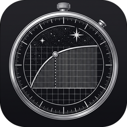
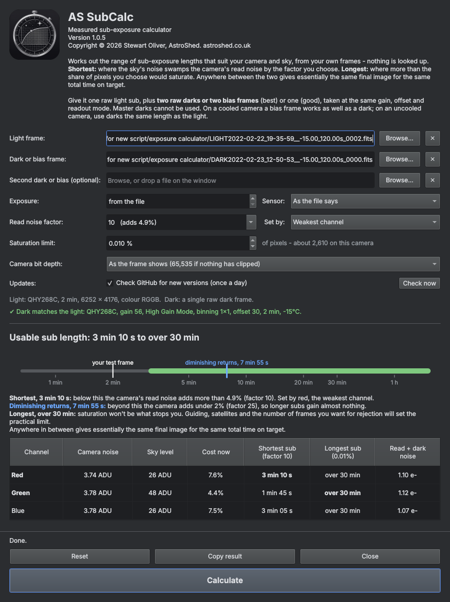

# AS SubCalc

**Measured sub-exposure calculator for astrophotography**, by AstroShed ([astroshed.co.uk](https://astroshed.co.uk)).

AS SubCalc works out the range of sub-exposure lengths that suit your camera and your sky, from your own frames. Nothing is looked up: no camera list, no published read noise, no e-/ADU figures. Published camera figures are often wrong; your own frames are not.

It reports two bookends:

- **Shortest sub:** the exposure at which the sky's noise swamps your camera's read noise by a factor you choose.
- **Longest sub:** the exposure beyond which more than a share of pixels you choose would saturate.

Anywhere between the two gives essentially the same final image for the same total time on target.

## Download

Go to [Releases](https://github.com/Astro5hed/AS-SubCalc/releases) and download the latest version. It runs on Windows.

Windows may show a "Windows protected your PC" message the first time, because the program is new and not yet widely downloaded. Choose **More info**, then **Run anyway**.

## What you need

- **One raw light sub**, straight from the camera: not calibrated, not debayered, not stretched. FITS or XISF.
- **Two raw darks or two bias frames** (best), or **one** (good), taken at the same gain, offset and readout mode as the light.

Some rules, which the app checks for you:

- Two frames must be the same kind and the same length: two darks, or two bias frames, never one of each.
- **Master darks cannot be used.** Stacking removes the very noise the app has to measure, and the answer comes out wrong.
- On a **cooled camera**, a bias frame works as well as a dark and takes a fraction of a second. On an **uncooled camera**, use darks the same length as the light.

The light can be any sub you have taken of a target with your usual filter. A short test frame at the start of the night is ideal.

## How to use it

1. Choose the light, then the dark or bias frame(s). You can also drop the files on the window.
2. Check the line under the file boxes. Green means the dark matches the light's settings; red means it does not.
3. Press **Calculate**.

### The settings

- **Read noise factor:** how far the sky's noise must swamp the camera's read noise. At factor 10 the camera adds 4.9% to the noise the sky alone would give. Higher means longer subs and a smaller penalty; beyond about 25 there is almost nothing left to gain. Pick from the list or type your own number.
- **Saturation limit:** the share of pixels that may saturate, mostly the cores of the brightest stars. 0.01% is a few thousand pixels on a typical sensor.
- **Camera bit depth:** only matters when no pixels in the test frame are saturated, so the camera's ceiling can't be read from it. Nearly all astro cameras give 16-bit values, including 12- and 14-bit sensors whose values are scaled up, which is what the app assumes. Choose an unscaled setting only if your files really top out at 4,095 or 16,383 (some DSLR conversions do).
- **Set by:** for colour cameras, which channel sets the shortest sub. The weakest channel is the default, so every channel ends up limited by the sky and not by the camera. The longest sub is always set by the channel that fills up first.

Changing the factor or the saturation limit updates the results straight away. Both are remembered.

### The results

- **Usable sub length:** the range between the two bookends, shown on a time scale with a mark where your test frame sits.
- **Diminishing returns:** the blue mark on the range bar. Beyond it the camera adds under 2% (factor 25), so longer subs gain almost nothing. If saturation stops you before that point, the app says so instead.
- **Over 30 min:** a longest sub beyond 30 minutes is not given as a figure. Saturation won't be what stops you; guiding, satellites and the number of frames you want will set the practical limit.
- **Camera noise:** the camera's own noise, measured from the dark.
- **Sky level:** how far the sky background sits above the dark in the test frame.
- **Cost now:** the extra noise the camera adds at the test frame's length. A small figure means the sub was already long enough.
- **Read noise:** the camera's read noise in electrons, measured from your frames. With darks it is shown as **Read + dark noise**, because a dark also holds a little dark-current noise; bias frames give the read noise alone. For interest only; the sub lengths do not depend on it.

If the two limits cross, the app says so. You then choose which matters more: a lower factor, more saturated pixels, or two sets of subs (long ones for the faint detail, short ones for the bright stars).

If the test frame already has more saturated pixels than the limit allows, the longest sub is shown as "or less", and a shorter test frame will measure it exactly.

## How it works

- The dark holds only the camera's own noise. The darkest patches of the light hold that same noise plus the sky's.
- Noise is measured from the difference between neighbouring pixels of the same colour, in small tiles, with stars and hot pixels clipped out, so gradients and nebulosity do not get in the way.
- Taking one from the other leaves the sky's share. Sky noise grows in step with exposure, so the exposure at which it reaches the chosen factor follows directly.
- For the longest sub, the dark is taken from the light pixel by pixel, which leaves only the light each pixel collected. Signal also grows in step with exposure, so the app works out when each pixel would reach the camera's clipping level.

Everything is worked out in the camera's own units, so gain, offset and readout mode never need to be known. Colour cameras are measured channel by channel.

## Updates

AS SubCalc can check this page once a day for a newer version, and shows a notice with a link to the download page if there is one. Nothing about you or your images is sent. The check can be turned off with the tick box in the app.

## Version history

See [CHANGELOG.md](CHANGELOG.md).

## Licence

AS SubCalc is freeware: free to use, but not open source. See [LICENSE.txt](LICENSE.txt).

If AS SubCalc has saved you some time at the telescope, a coffee is always appreciated:

Copyright © 2026 Stewart Oliver, AstroShed. [astroshed.co.uk](https://astroshed.co.uk)
